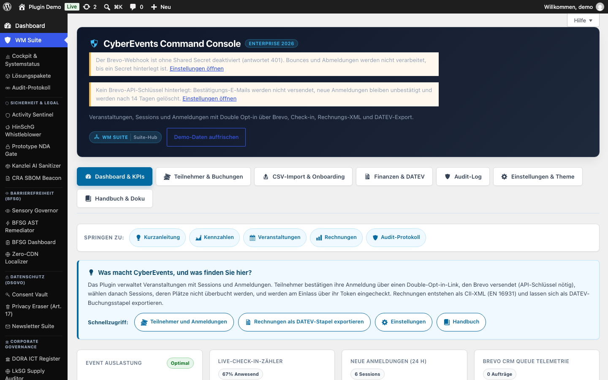
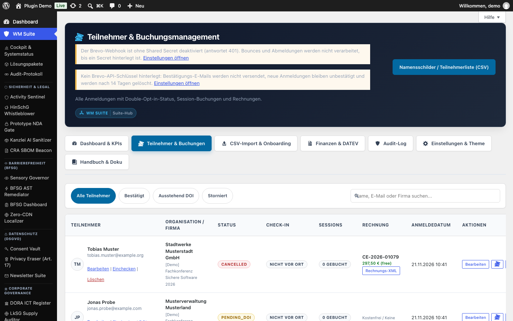
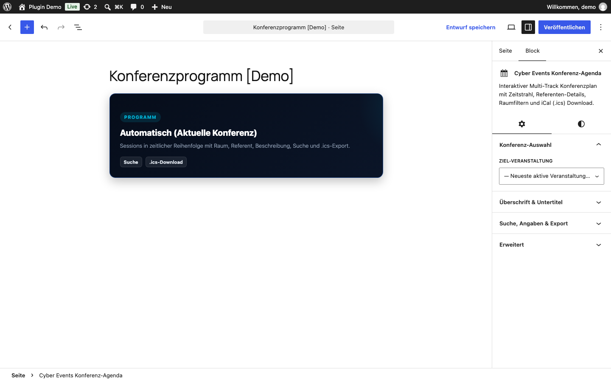
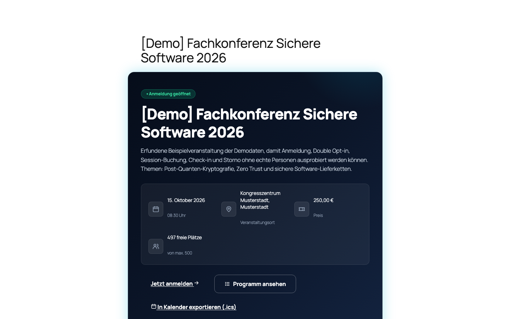

# WM Cyber Events Core (Deutsche Dokumentation)

<p align="center">
  <a href="README.md"></a>
  <a href="README.de.md"></a>
  <a href="README.es.md"></a>
</p>

> **Veranstaltungen, Sessions und Anmeldungen für WordPress mit Double Opt-in über Brevo, Session-Buchung mit Kapazitätsprüfung, Check-in, Rechnungs-XML (EN 16931) und DATEV-Export**  
> **Plugin-Seite:** [https://arnoldwender.com/wordpress-plugins/wm-cyber-events-core/](https://arnoldwender.com/wordpress-plugins/wm-cyber-events-core/)  
> **Mit einem agentischen Workflow entwickelt:** entstanden mit KI-Coding-Agenten. Prüfen und testen Sie es wie jeden fremden Code, bevor Sie es produktiv einsetzen.  
> **Support & Haftung:** Kein Support (Zero Support) — reproduzierbare Bugs ausschließlich über [GitHub Issues](https://github.com/arnoldwender/wm-wp-cyber-events-core/issues) · kein privater Support · OHNE GEWÄHR („AS IS“) / keine Haftung ([SUPPORT.md](SUPPORT.md))

> Diese Datei beschreibt, was das Plugin ausliefert, gemessen am Code. Eine frühere Fassung nannte ein nicht registriertes Tag `wm_cyber_calendar` (der registrierte Shortcode lautet `[cybevents_calendar]`), WP-CLI-Befehle `wp cybevents status|verify|export`, einen REST-Namespace `wm-events/v1`, ZUGFeRD-2.3-/Factur-X-Hybridrechnungen als PDF/A-3, Zeilensperren „unter hoher Last“ sowie GoBD- und BFSG-2025-Konformität; nichts davon existiert in diesem Repository. Das zugrunde liegende Code-Audit: docs/AUDIT-2026-09-15.md.

---

## Live-Vorschau

!WM Cyber Events Core Banner

| Steuerkonsole | Teilnehmerverwaltung | Gutenberg-Editor | Öffentliches Portal |
|---|---|---|---|
|  |  |  |  |

---

## Was das Plugin leistet

1. **Veranstaltungen, Sessions, Orte:** Beitragstypen `cybevent` (Archiv unter `/veranstaltungen/`) und `cybsession`, Taxonomie `cybvenue` mit Adresse, Kapazität, Rollstuhl-Angabe und Kartenlink. Beim Speichern im Editor werden die Felder in die Plugin-Tabellen `wp_cybevents_events` und `wp_cybevents_sessions` übernommen, aus denen Blöcke, REST-Routen und Exporte lesen. Veranstaltungen lassen sich auch in der Schnellbearbeitung des Plugin-Dashboards anlegen und bearbeiten, dort zusätzlich mit dem Status „Archiviert“.
2. **Anmeldung mit Double Opt-in:** Das Anmeldeformular (Block oder `[cybevents_registration event_id="…"]`) sendet an `POST /wp-json/cybevents/v1/register`: Vorname, Nachname, E-Mail, Firma (optional), Profilfoto (JPEG, PNG oder WebP bis 5 MB, optional), Einwilligung Datenschutz (Pflicht) und Foto. Höchstens 15 Anfragen pro Minute je IP; ein ausgefülltes verstecktes Honeypot-Feld wird abgewiesen. Die Anmeldung wird als `pending_doi` mit SHA-256-Hashes von Teilnehmer- und DOI-Token gespeichert, ein Warteschlangen-Job beauftragt Brevo (`POST /v3/contacts/doubleOptinConfirmation`, Vorlage und Liste aus den Einstellungen) mit der Bestätigungs-E-Mail. Der Link darin führt zu `GET /wp-json/cybevents/v1/confirm`, das die Anmeldung einmalig bestätigt und auf die erste veröffentlichte Seite mit der Session-Auswahl weiterleitet. Ohne Brevo-API-Schlüssel wird keine E-Mail versendet; das Backend weist darauf hin.
3. **Session-Buchung:** Bestätigte Teilnehmer wählen auf dieser Seite Sessions (Block oder `[cybevents_session_selector]`, Token aus dem Link). Jeder Platz wird mit einem einzigen bedingten `UPDATE … SET belegt = belegt + 1 WHERE id = … AND belegt < kapazitaet` vergeben, zwei Anfragen auf den letzten Platz können ihn nicht beide erhalten. Bei einer Änderung werden zuerst die neuen Plätze gebucht und die alten erst freigegeben, wenn alle neuen gesichert sind.
4. **Warteraum (Zulassungen):** Standardmäßig aus (`admission_per_minute`, 0). Mit einer Zahl zählt er die Anfragen an `POST /register` und `POST /book-sessions` pro Minute, je Gate und je Veranstaltung, und beantwortet alles über dem Limit mit HTTP 503 und `Retry-After` — **bevor eine Buchungsabfrage läuft**. Am 2026-09-16 in einer lokalen WordPress-Installation mit dem Datenbank-Backend gemessen: eine zugelassene Buchung kostet 16 Abfragen, eine abgewiesene 2 — den Transient, der der Zähler selbst ist. Mit persistentem Objekt-Cache kostet die abgewiesene keine. Es ist eine Drossel, keine Warteschlange: eine abgewiesene Anfrage hält keinen Platz, und die Antwort sagt das auch so. Mit persistentem Objekt-Cache (Redis, Memcached) ist der Zähler ein atomares Inkrement dort; ohne einen ist er ein Transient, eine abgewiesene Anfrage kostet also weiterhin einen Lese- und einen Schreibzugriff auf die Optionstabelle. Die Einstellungsseite nennt das verwendete Backend und warnt, wenn es die Datenbank ist; `wp cybevents admission [--event=<id>] [--reset]` zeigt und leert das laufende Fenster, und der Hub meldet `admission_limit` und `admission_backend`.
5. **Sitzplan:** Die Belegung jeder Session einer Veranstaltung als SVG — eine Zelle je Platz, eine Zeile je Session — aus dem Block *Cyber Events Sitzplan* oder `[cybevents_seat_map event_id="…"]`. Er bleibt über Server-Sent Events aktuell: `GET /wp-json/cybevents/v1/seat-stream?event_id=…` hält die Verbindung 30 Sekunden offen, schreibt ein Ereignis nur bei geänderter Belegung, sendet alle 10 Sekunden eine Keep-alive-Zeile und bittet den Browser dann um eine neue Verbindung — ein verbundener Betrachter belegt so lange einen PHP-Prozess, deshalb ist der Strom begrenzt. Der Strom trägt nur Belegungszahlen: keine Namen, keine Adressen, keine Token, deshalb braucht er auch keines. Eine Session über 400 Plätze wird als Balken statt als 400 Rechtecke gezeichnet; eine Tabelle neben der Zeichnung trägt dieselben Zahlen für Screenreader. Mit `?token=` einer bestätigten Anmeldung sind die eigenen Zeilen markiert, und ein Klick bucht oder gibt einen Platz frei über `POST /book-sessions` — das bedingte `UPDATE` entscheidet weiterhin über den letzten Platz; das Token wird aus der URL gelesen und nie in das Markup geschrieben. Einen WebSocket gibt es nicht: WordPress hat keinen Socket-Server.
6. **Check-in und Teilnehmerpass:** `POST /wp-json/cybevents/v1/checkin` (Administrator oder Header `X-CyberEvents-Staff-Key` mit dem Staff-Schlüssel aus den Einstellungen) checkt eine bestätigte Anmeldung genau einmal ein, ein zweiter Scan erhält 409. Der Block Teilnehmerpass und `GET /wp-json/cybevents/v1/ticket?token=…` zeigen nur bestätigte Anmeldungen (ausgeliefert mit `private, no-store`). In der Teilnehmerliste lässt sich der Check-in von Hand umschalten.
7. **Frontend-Blöcke** in der Kategorie „Cyber Events Suite“: Event Hero (Countdown, Datum, Ort, Preis, freie Plätze, Buttons), Anmeldeformular, Agenda (Sessions in zeitlicher Reihenfolge mit Raum, Referent, Suche und `.ics`-Export; auch `[cybevents_agenda]`), Referenten-Raster, Kalender-Widget (`.ics`-Download und Links zu Google Kalender, Outlook Web und Microsoft 365), Session-Auswahl, Teilnehmerpass, Vertrauensblock (Karten zu Double Opt-in und Löschfristen, beschrifteten Formularen, eigenen Assets, Audit-Log und Tokens, Rechnungs-XML und DATEV), Veranstaltungsraster (aktive, aktive und archivierte oder archivierte Veranstaltungen) und Calendar Views (7 dynamische Ansichten über gespeicherte aktive Veranstaltungen und Sessions mit optionalem `month`-Attribut bzw. `[cybevents_calendar month="YYYY-MM"]` oder `?cyb_month=YYYY-MM`). Überschriften, Buttons und Badges ergeben sich aus der Veranstaltung und sind übersetzbar; der Editor bietet nur Einstellungen an, die die Renderer lesen.
8. **Kalenderdateien:** `GET /wp-json/cybevents/v1/calendar?event_id=…` liefert die Veranstaltung als `.ics` mit einer Erinnerung einen Tag vorher; mit `?token=…` zusätzlich die gebuchten Sessions, jeweils mit Erinnerung 15 Minuten vorher. Zeiten werden aus der Zeitzone der Website nach UTC umgerechnet.
9. **Rechnungs-XML:** `CyberEvents_Invoicing::create_invoice()` und `cancel_invoice()` schreiben Cross-Industry-Invoice-XML mit der Guideline-ID EN 16931: Rechnungen (Typ 380) und Gutschriften (Typ 381, positive Beträge, Verweis auf das Original), Rechnungssteller aus den Einstellungen (ohne diese keine Rechnung), Beträge in Cent gerechnet, SEPA-Zahlungsart bei hinterlegter IBAN, Nummern aus einem Zähler, der nie zurückgesetzt wird. Das XML wird mit der Rechnung gespeichert und lässt sich in der Teilnehmerliste ansehen und kopieren. Die Testsuite validiert es mit Mustang-CLI. Der Anmeldeablauf ruft diese Funktionen nicht auf (siehe Bekannte Probleme).
10. **Exporte:** Teilnehmerliste als CSV (bestätigte Anmeldungen, Semikolon, Zellen mit führendem `=`, `+`, `-` oder `@` neutralisiert; erfordert eine Bestätigung und erzeugt einen Audit-Eintrag). DATEV EXTF 700, Buchungsstapel Kategorie 21, Version 13, für einen Zeitraum innerhalb eines Kalenderjahres, in Windows-1252, mit Forderungs- und Erlöskonto aus den Einstellungen. WordPress-Datenschutz-Export und -Löschung für Anmeldungen und Rechnungen.
11. **CSV-Import** von Teilnehmern in eine Veranstaltung (Spalten `email`/`E-Mail`, `vorname`/`first_name`, `nachname`/`last_name`, `firma`/`company`; Semikolon oder Komma); bereits angemeldete Adressen werden übersprungen. Importierte Personen werden als bestätigt gespeichert, ohne Datenschutz-Einwilligung, ohne DOI-Zeitpunkt und ohne nutzbares Token; es wird keine E-Mail versendet.
12. **Löschfristen und Audit-Log:** Ein täglicher Cron löscht nach 14 Tagen unbestätigte Anmeldungen (mit Freigabe ihrer Plätze und Löschung des Fotos) und pseudonymisiert Audit-Einträge, die älter als 90 Tage sind, außer Rechnungsereignissen. Jeder Audit-Eintrag ist per HMAC-SHA256 verkettet (Schlüssel aus `AUTH_KEY` in der `wp-config.php`, sonst ein in der Datenbank gespeicherter Schlüssel, worauf das Backend hinweist); `wp cybevents verify-audit` und die Audit-Seite melden den ersten Eintrag, der nicht stimmt. Manipulationsnachweis, keine Unveränderbarkeit. Die Selbststornierung (`POST /wp-json/cybevents/v1/cancel-registration` mit Teilnehmer-Token) gibt Plätze frei, erzeugt bei vorhandener Rechnung eine Gutschrift und stellt eine Brevo-Kontaktaktualisierung in die Warteschlange.
13. **Brevo-Webhook:** `POST /wp-json/cybevents/v1/brevo-webhook` mit Header `X-Brevo-Webhook-Secret`: `hard_bounce`, `soft_bounce`, `spam` und `unsubscribed` setzen alle Anmeldungen dieser Adresse auf `bounced` und geben ihre Plätze frei. Ohne Secret in den Einstellungen antwortet die Route mit 401.
14. **Backend:** Menü *Cyber Events* (Berechtigung `manage_options`): Dashboard mit Zählwerten aus den Tabellen, Veranstaltungstabelle und Schnellbearbeitung, Rechnungsübersicht und letzten Audit-Einträgen; Veranstaltungen, Orte und Sessions; Teilnehmer (Filter, Suche, Bearbeitungsdialog mit Foto, Status, Check-in, Rechnungsnummer und Einwilligungen; manuelle DOI-Bestätigung; Löschen; CSV-Export; XML-Ansicht); CSV-Import; DATEV-Export; Audit-Log mit Kettenprüfung; Einstellungen (Design, Brevo und Staff-Schlüssel, Rechnungssteller und DATEV-Konten, Captcha, Demodaten und Werkseinstellungen); Handbuch. Dashboard-Widget mit Zahl der Veranstaltungen, bestätigten und ausstehenden Anmeldungen; Hilfe-Tabs auf den Plugin-Seiten.
15. **Design:** Presets: Farben und Schriften des aktiven Themes übernehmen (Standard), mehrere Farb-Presets, Hochkontrast (Schwarz auf Weiß) oder eigene Farben mit hochgeladener `.css`-Datei (bis 2 MB, Tags entfernt) und Inline-CSS. Das Plugin lädt keine Schriftdateien. Themes können `cybevents/single-cybevent.php`, `cybevents/archive-cybevent.php` und `cybevents/single-cybsession.php` überschreiben.
16. **WP-CLI:** `wp cybevents list` (Veranstaltungen mit der Zahl bestätigter Anmeldungen), `wp cybevents queue-run`, `wp cybevents verify-audit` (Exit-Code 1 bei gebrochener Kette), `wp cybevents admission [--event=<id>] [--reset]` (Zustand und Zähler des Warteraums), `wp cybevents demodaten --import|--delete|--reset`.
17. **WM Suite Hub Spoke:** `includes/class-cyber-events-spoke-adapter.php` meldet sich über `wm_register_suite_module`: Zustand (`ERROR` bei gebrochener Audit-Kette, `NEEDS_CONFIG` ohne Brevo-Schlüssel oder Webhook-Secret, `DEGRADED` ohne Warteschlangen-Event oder mit fehlgeschlagenen Jobs), Zählwerte als Telemetrie, SBOM-Eintrag mit SHA-256 der Hauptdatei, Aktionen `self_test` und `audit_verify`.
18. **Ökosystem-Brücken & Entwickler-Hooks:** Registriert die WordPress-6.5+-Block-Bindings-Quelle `wm-cybevents/metrics`, das GenerateBlocks-2.x-Dynamic-Tag `wm_cybevents_metric`, die Action `wm_cybevents_ready` sowie die Filter `wm_cybevents_metric_value`, `wm_cybevents_public_rest_rate_limit` und `wm_cybevents_ics_output`.

### Nicht enthalten

Keine Rechnung und keine Zahlung im Anmeldeablauf, kein PDF und keine ZUGFeRD-/Factur-X-Hybriddatei, keine XRechnung-Leitweg-ID, kein QR-Code, kein funktionierendes Captcha-Widget, keine Warteliste, kein WebSocket (der Sitzplan überträgt per Server-Sent Events), kein E-Mail-Versand durch das Plugin selbst (die Bestätigungs-E-Mail versendet Brevo), keine Track-Filter in der Agenda und keine Aussage, dass eine Website mit dem Plugin DSGVO, BFSG oder steuerliche Anforderungen erfüllt.

---

## Schnellstart

1. Plugin installieren und aktivieren (WordPress 6.9+, PHP 8.3+). Die Aktivierung legt ausschließlich Tabellen, Standardoptionen und Cronjobs an; optionale erfundene Demodaten lassen sich bei Bedarf unter **Cyber Events › Einstellungen › Demodaten & Reset** oder über `wp cybevents demodaten --import` importieren.
2. **Cyber Events › Einstellungen** öffnen: unter *Brevo CRM & Webhooks* API-Schlüssel, DOI-Vorlagen-ID (eine Double-Opt-in-Vorlage in Brevo) und Listen-ID, ein Webhook-Secret und, falls ein Scanner die Check-in-Route aufruft, einen Staff-Schlüssel eintragen; unter *Rechnungen & DATEV* die Rechnungsstellerdaten, falls Rechnungen genutzt werden.
3. Unter **Cyber Events › Neue Veranstaltung** eine Veranstaltung anlegen (Datum, Ort, Kapazität, Preis) und unter **Neue Session** ihre Sessions mit ausgewählter Veranstaltung.
4. Den Block Anmeldeformular (oder `[cybevents_registration event_id="…"]`) auf eine Seite setzen und den Block Session-Auswahl (oder `[cybevents_session_selector]`) auf eine veröffentlichte Seite: der Bestätigungslink führt zur ersten solchen Seite.
5. Sicherstellen, dass WP-Cron jede Minute läuft (auf Websites mit wenig Verkehr ein echter Cronjob) oder `wp cybevents queue-run` ausführen, sonst verlässt keine Bestätigungs-E-Mail die Warteschlange.

Optionen, Tabellen und Tests: **[README.md](README.md)** (Referenz) und **[DEVELOPERS.md](DEVELOPERS.md)**.

```bash
php tests/test-suite.php          # 154 Standalone-Prüfungen, ohne WordPress
bash tests/run-mutations.sh       # 215 Mutationen, jede muss die Suite rot machen
bash tests/validate-invoice-xml.sh   # Rechnungs- und Gutschrift-XML mit Mustang-CLI (Java 11+)
```

---

## Bekannte Probleme

- **Optionaler Demodaten-Import.** *Demo-Daten auffrischen* (Dashboard), *Demodaten importieren* (*Einstellungen › Demodaten & Reset*) sowie `wp cybevents demodaten --import` legen bei ausdrücklichem Aufruf eine veröffentlichte Beispielveranstaltung „[Demo] Fachkonferenz Sichere Software 2026“ (250 €), zwei Demo-Seiten, vier Orte, sechs Sessions und fünf Anmeldungen an. Alle Namen, Adressen und Firmen sind erfunden; E-Mail-Adressen und Websites nutzen die reservierten Domains `example.com`, `example.org` und `example.net`. *Demodaten bereinigen* entfernt die `[Demo]`-Datensätze samt Sessions, Anmeldungen, Rechnungen, Demo-Orten und aufgezeichneten Demo-Seiten.
- **Calendar Views** (`[cybevents_calendar]`, `[cybevents_calendar_views]`, `[wm_events_views]` und Block) liest gespeicherte aktive Veranstaltungen und Sessions dynamisch aus der Datenbank und zeigt ohne Daten einen neutralen Leerzustand.
- **Kostenpflichtige Veranstaltungen** zeigen ihren Preis; der Anmeldeablauf erzeugt keine Rechnung und nimmt keine Zahlung an. Rechnungen entstehen nur durch den Demodaten-Import, Gutschriften durch die Selbststornierung einer Anmeldung mit Rechnung.
- **Berechtigungen:** Veranstaltungen und Sessions nutzen den Berechtigungstyp `post`, Autoren können sie also anlegen; eine Session im Entwurf ist bei aktiver Veranstaltung buchbar; Speichern im Block-Editor setzt den Status „Archiviert“ auf aktiv oder Entwurf zurück.
- **Löschen einer Veranstaltung** im Dashboard entfernt ihre Tabellenzeile und verschiebt den Beitrag in den Papierkorb; Sessions, Anmeldungen und Rechnungen bleiben.
- **Importierte Teilnehmer** haben kein Token und können weder die Session-Auswahl noch den Teilnehmerpass oder eine Stornierung aufrufen.
- **Routen ohne mitgelieferte Oberfläche:** Check-in, Ticket, Stornierung, Foto-Upload und Orte sind REST-Routen; keine Seite und kein Skript des Plugins ruft sie auf, und das Plugin verschickt keinen Stornierungslink.
- **Friendly Captcha** hat keine Wirkung: das mitgelieferte Skript rendert kein Widget, die Prüfung wird übersprungen.
- **Ability** `cybevents/manage-registrations` (Abilities API) liefert `success` ohne Daten.
- **DATEV:** Jede Zeile trägt Steuerschlüssel 3; Konten und Schlüssel sind mit der Steuerberatung abzustimmen.
- **Veranstaltungsraster:** Die Buttons verlinken auf `#cybevents-registration-form` derselben Seite, egal welche Veranstaltung die Karte zeigt.

---

## Konformität

- **Keine externen Assets:** Skripte, Styles und Icons kommen aus dem Plugin; keine Schriften, kein CDN, kein Tracking. Der Server spricht nur mit Brevo, wenn ein API-Schlüssel hinterlegt ist; die Kalenderlinks öffnen Google oder Microsoft erst beim Klick im Browser.
- **Personenbezogene Daten:** Name, E-Mail, Firma, optionales Foto, Einwilligungen, DOI- und Check-in-Zeitpunkte und Session-Buchungen liegen in den Plugin-Tabellen; Name, E-Mail, Firma und Veranstaltungstitel gehen für die Bestätigungs-E-Mail an Brevo, zusammen mit der Listen-ID aus den Einstellungen. Unbestätigte Anmeldungen werden nach 14 Tagen gelöscht; bestätigte Anmeldungen und Rechnungen werden nicht automatisch gelöscht. Datenschutz-Export und -Löschung von WordPress erfassen Anmeldungen, Rechnungen, Audit-Einträge und wartende E-Mails.
- **Barrierefreiheit:** Formularfelder mit sichtbaren Beschriftungen, markierte Pflichtfelder, Rückmeldungen in einer Live-Region, ein Hochkontrast-Preset, sichtbare Fokusrahmen. Eine Konformitätsaussage wird nicht getroffen.
- **Rechnungen:** Das XML wird in den Tests mit Mustang-CLI gegen EN 16931 geprüft; ob Rechnungen im Einzelfall die gesetzlichen Anforderungen erfüllen, entscheidet die Steuerberatung.

---

## Lizenz

Lizenziert unter der **GNU General Public License v2 oder später** (`LICENSE`); Plugin-Header, `readme.txt` und das SBOM, das das Plugin an den Hub meldet (`GPL-2.0-or-later`), sagen dasselbe.  
Copyright (C) 2026 Arnold Wender.  
