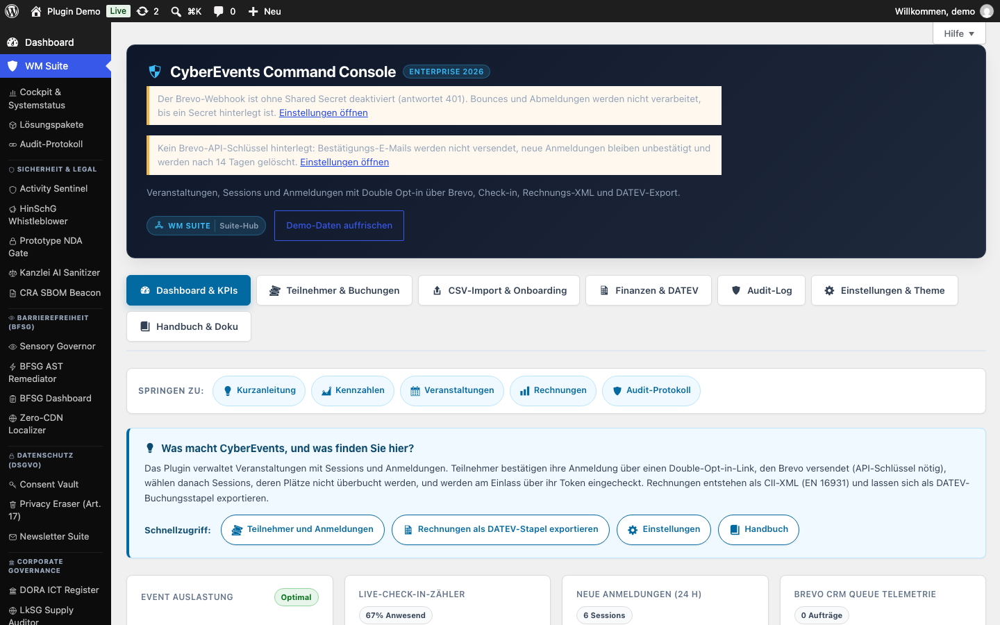
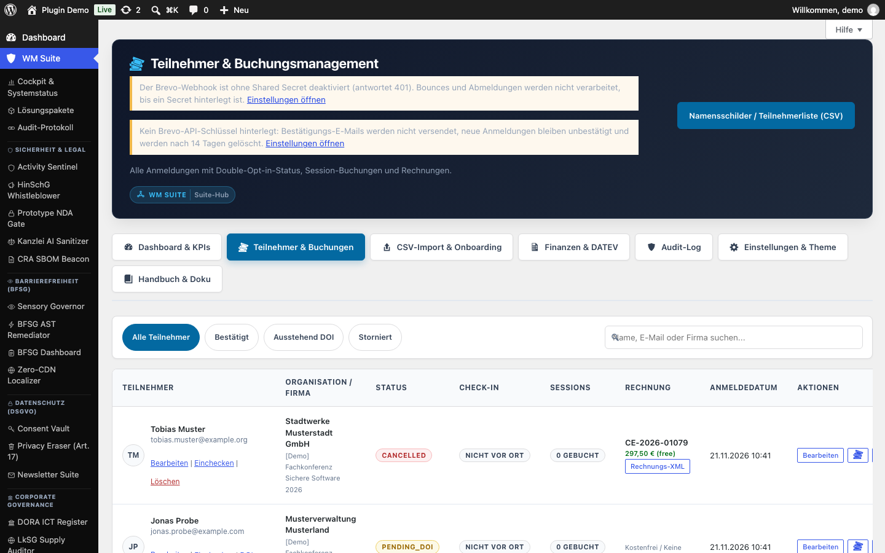
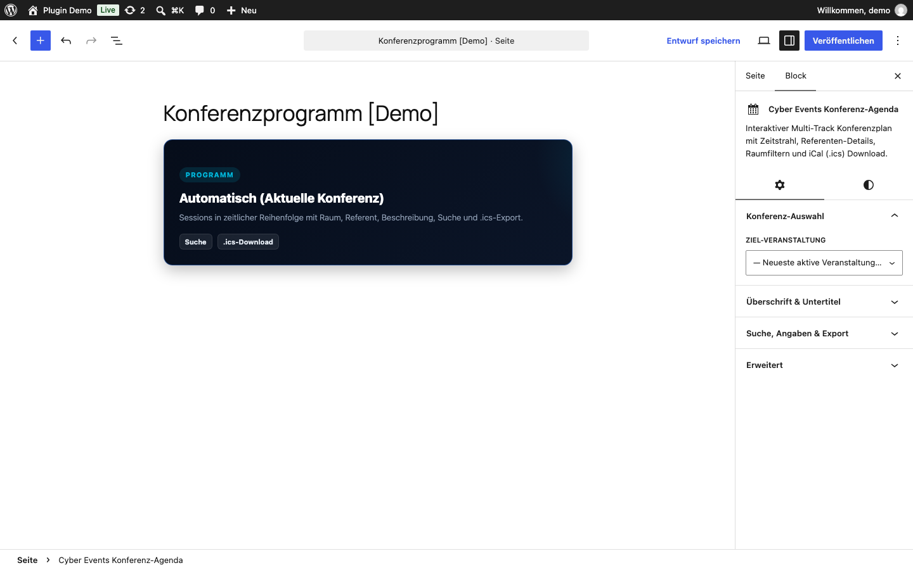
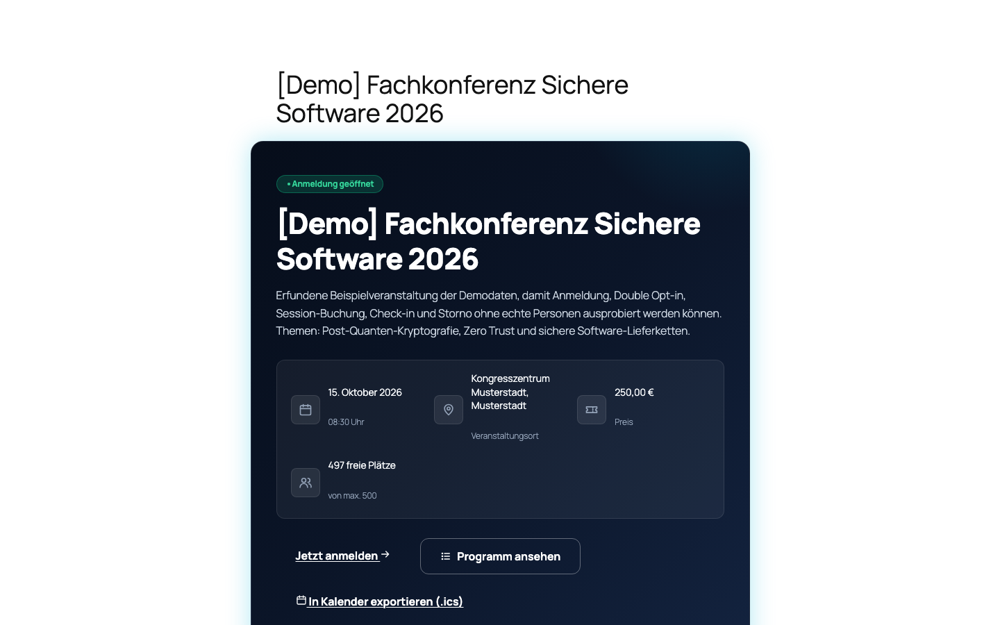

# WM Cyber Events Core (Documentación en Español)

<p align="center">
  <a href="README.md"></a>
  <a href="README.de.md"></a>
  <a href="README.es.md"></a>
</p>

> **Eventos, sesiones e inscripciones para WordPress con doble opt-in a través de Brevo, reserva de sesiones con control de aforo, check-in, XML de factura (EN 16931) y exportación DATEV**  
> **Página del plugin:** [https://arnoldwender.com/es/plugins-wordpress/wm-cyber-events-core/](https://arnoldwender.com/es/plugins-wordpress/wm-cyber-events-core/)  
> **Desarrollado con un agentic workflow:** creado con agentes de programación de IA. Revísalo y pruébalo como cualquier código de terceros antes de usarlo en producción.  
> **Soporte y responsabilidad:** Cero soporte (Zero Support) — errores reproducibles únicamente en [GitHub Issues](https://github.com/arnoldwender/wm-wp-cyber-events-core/issues) · sin soporte privado · TAL CUAL («AS IS») / sin responsabilidad ([SUPPORT.md](SUPPORT.md))

> Este archivo describe lo que el plugin entrega, medido contra el código. Una edición anterior describía una etiqueta no registrada `wm_cyber_calendar` (el shortcode registrado es `[cybevents_calendar]`), comandos WP-CLI `wp cybevents status|verify|export`, un namespace REST `wm-events/v1`, facturas híbridas ZUGFeRD 2.3 / Factur-X en PDF/A-3, bloqueos de fila «bajo alta concurrencia» y cumplimiento de GoBD y BFSG 2025; nada de eso existe en este repositorio. La auditoría de código detrás de esta reescritura: docs/AUDIT-2026-09-15.md.

---

## Capturas en vivo

!Banner de WM Cyber Events Core

| Consola de Eventos | Gestión de Asistentes | Editor Gutenberg | Portal Público Multivista |
|---|---|---|---|
|  |  |  |  |

---

## Qué hace el plugin

1. **Eventos, sesiones y sedes.** Tipos de contenido `cybevent` (archivo en `/veranstaltungen/`) y `cybsession`, y la taxonomía de sedes `cybvenue` con dirección, aforo, indicación de acceso en silla de ruedas y enlace a mapa. Al guardar un evento o una sesión en el editor, sus campos se copian a las tablas `wp_cybevents_events` y `wp_cybevents_sessions`, que leen los bloques, las rutas REST y las exportaciones. Los eventos también se crean y editan en la edición rápida del dashboard del plugin, que además permite el estado «archivado».
2. **Inscripción con doble opt-in.** El formulario (bloque o `[cybevents_registration event_id="…"]`) envía a `POST /wp-json/cybevents/v1/register`: nombre, apellido, correo, empresa (opcional), foto de perfil (JPEG, PNG o WebP hasta 5 MB, opcional), consentimiento de privacidad (obligatorio) y de fotos. Máximo 15 peticiones por minuto por IP; si el campo trampa oculto viene lleno, la petición se rechaza. La inscripción se guarda como `pending_doi` con hashes SHA-256 del token de participante y del token DOI, y una tarea de la cola pide a Brevo (`POST /v3/contacts/doubleOptinConfirmation`, plantilla y lista de los ajustes) que envíe el correo de confirmación. El enlace de ese correo lleva a `GET /wp-json/cybevents/v1/confirm`, que confirma la inscripción una sola vez y redirige a la primera página publicada que contiene el selector de sesiones. Sin clave API de Brevo no sale ningún correo y el panel lo avisa.
3. **Reserva de sesiones.** Quien ya confirmó elige sesiones en esa página (bloque o `[cybevents_session_selector]`, token del enlace). Cada plaza se toma con un único `UPDATE … SET belegt = belegt + 1 WHERE id = … AND belegt < kapazitaet`, así que dos peticiones por la última plaza no pueden obtenerla ambas. Al cambiar la selección se reservan primero las sesiones nuevas y las anteriores solo se liberan cuando todas las nuevas quedaron aseguradas.
4. **Sala de espera de admisión.** Apagada por defecto (`admission_per_minute`, 0). Con un número, cuenta las peticiones que llegan a `POST /register` y `POST /book-sessions` por minuto, por puerta y por evento, y responde a todo lo que pase del límite con HTTP 503 y `Retry-After` **antes de que corra una consulta de reserva**. Medido en una instalación local de WordPress el 2026-09-16 con el backend de base de datos: una reserva admitida cuesta 16 consultas y una rechazada 2 — el transient que es el propio contador. Con caché de objetos persistente la rechazada no cuesta ninguna. Es un limitador, no una cola: la petición rechazada no guarda plaza, y la respuesta lo dice con todas las letras. Con caché de objetos persistente (Redis, Memcached) el contador es un incremento atómico ahí; sin ella es un transient, así que la petición rechazada sigue costando una lectura y una escritura en la tabla de opciones. La pantalla de ajustes nombra el backend en uso y avisa cuando es la base de datos; `wp cybevents admission [--event=<id>] [--reset]` muestra y limpia la ventana actual, y el hub informa `admission_limit` y `admission_backend`.
5. **Mapa de asientos.** La ocupación de cada sesión de un evento como SVG — una celda por plaza, una fila por sesión — desde el bloque *Cyber Events Sitzplan* o `[cybevents_seat_map event_id="…"]`. Se mantiene al día por Server-Sent Events: `GET /wp-json/cybevents/v1/seat-stream?event_id=…` sostiene la conexión 30 segundos, escribe un evento solo cuando la ocupación cambia, manda una línea de keep-alive cada 10 segundos y luego pide al navegador que reconecte — cada espectador conectado ocupa un proceso PHP ese rato, por eso el flujo está acotado. El flujo lleva solo números de ocupación: ni nombres, ni direcciones, ni tokens, y por eso no pide ninguno. Una sesión de más de 400 plazas se dibuja como barra en vez de 400 rectángulos; una tabla junto al dibujo lleva las mismas cifras para lectores de pantalla. Con `?token=` de una inscripción confirmada se marcan las filas propias y un clic reserva o libera una plaza vía `POST /book-sessions`, así que el `UPDATE` condicional sigue decidiendo la última plaza; el token se lee de la URL y nunca se escribe en el marcado. No hay WebSocket: WordPress no tiene servidor de sockets.
6. **Check-in y pase de participante.** `POST /wp-json/cybevents/v1/checkin` (un administrador, o la cabecera `X-CyberEvents-Staff-Key` con la clave de personal de los ajustes) registra la entrada de una inscripción confirmada exactamente una vez; un segundo escaneo responde 409. El bloque del pase y `GET /wp-json/cybevents/v1/ticket?token=…` muestran solo inscripciones confirmadas (con `private, no-store`). En la lista de participantes el check-in se cambia a mano.
7. **Bloques de frontend** en la categoría «Cyber Events Suite»: Event Hero (cuenta regresiva, fecha, sede, precio, plazas libres, botones), Formulario de inscripción, Agenda (sesiones en orden cronológico con sala, ponente, búsqueda y exportación `.ics`; también `[cybevents_agenda]`), Rejilla de ponentes, Widget de calendario (descarga `.ics` y enlaces a Google Calendar, Outlook Web y Microsoft 365), Selector de sesiones, Pase de participante, Bloque de confianza (tarjetas sobre doble opt-in y plazos de borrado, formularios con etiquetas, recursos propios, registro de auditoría y tokens, XML de factura y DATEV), Rejilla de eventos (activos, activos y archivados, o archivados) y Calendar Views (7 vistas dinámicas sobre eventos activos y sesiones guardadas en la base de datos, con atributo opcional `month` / `[cybevents_calendar month="YYYY-MM"]` o `?cyb_month=YYYY-MM`). Títulos, botones y distintivos salen del evento y son traducibles; el editor solo ofrece ajustes que los renderizadores leen.
8. **Archivos de calendario.** `GET /wp-json/cybevents/v1/calendar?event_id=…` devuelve el evento como `.ics` con un recordatorio un día antes; con `?token=…` añade las sesiones reservadas, cada una con recordatorio 15 minutos antes. Las horas se convierten de la zona horaria del sitio a UTC.
9. **XML de factura.** `CyberEvents_Invoicing::create_invoice()` y `cancel_invoice()` escriben XML Cross Industry Invoice con el identificador de guía EN 16931: facturas (tipo 380) y notas de crédito (tipo 381, importes positivos, referencia a la original), emisor tomado de los ajustes (sin esos datos no hay factura), importes calculados en céntimos, medio de pago SEPA cuando hay IBAN, números de un contador que nunca retrocede. El XML se guarda con la factura y se puede ver y copiar en la lista de participantes. La suite de pruebas lo valida con Mustang-CLI. El flujo de inscripción no llama a estas funciones (ver Problemas conocidos).
10. **Exportaciones.** Lista de participantes en CSV (inscripciones confirmadas, punto y coma, celdas que empiezan con `=`, `+`, `-` o `@` neutralizadas; exige marcar una confirmación y deja una entrada de auditoría). Lote de asientos DATEV EXTF 700, categoría 21, versión 13, para un periodo dentro de un año natural, en Windows-1252, con las cuentas de clientes e ingresos de los ajustes. Exportador y borrador de datos personales de WordPress para inscripciones y facturas.
11. **Importación CSV** de participantes a un evento (columnas `email`/`E-Mail`, `vorname`/`first_name`, `nachname`/`last_name`, `firma`/`company`; punto y coma o coma), omitiendo correos ya inscritos en ese evento. Las personas importadas quedan confirmadas, sin consentimiento de privacidad, sin fecha de DOI y sin token utilizable; no se envía correo.
12. **Plazos de borrado y auditoría.** Un cron diario borra las inscripciones sin confirmar tras 14 días (liberando sus plazas y borrando la foto) y seudonimiza las entradas de auditoría con más de 90 días, salvo los eventos de facturas. Cada entrada de auditoría se encadena con HMAC-SHA256 (clave de `AUTH_KEY` en `wp-config.php`, si no, una clave guardada en la base de datos, cosa que el panel señala); `wp cybevents verify-audit` y la pantalla de auditoría informan la primera entrada que no cuadra. Evidencia de manipulación, no inmutabilidad. La cancelación por la propia persona (`POST /wp-json/cybevents/v1/cancel-registration` con el token) libera las plazas, emite una nota de crédito si había factura y encola una actualización del contacto en Brevo.
13. **Webhook de Brevo.** `POST /wp-json/cybevents/v1/brevo-webhook` con la cabecera `X-Brevo-Webhook-Secret`: `hard_bounce`, `soft_bounce`, `spam` y `unsubscribed` marcan como `bounced` todas las inscripciones de esa dirección y liberan sus plazas. Sin secreto en los ajustes la ruta responde 401.
14. **Panel de administración.** Menú *Cyber Events* (capacidad `manage_options`): dashboard con conteos de las tablas, tabla de eventos y edición rápida, resumen de facturas y últimas entradas de auditoría; eventos, sedes y sesiones; participantes (filtro, búsqueda, diálogo de edición con foto, estado, check-in, número de factura y consentimientos; confirmación DOI manual; borrado; exportación CSV; visor de XML); importación CSV; exportación DATEV; auditoría con verificación de la cadena; ajustes (diseño, Brevo y clave de personal, emisor de facturas y cuentas DATEV, captcha, datos demo y restablecimiento de fábrica); manual. Widget del escritorio con eventos, inscripciones confirmadas y pendientes; pestañas de ayuda en las pantallas del plugin.
15. **Diseño.** Presets: heredar colores y fuentes del tema activo (por defecto), varios presets de color, alto contraste (negro sobre blanco) o colores propios con archivo `.css` subido (hasta 2 MB, sin etiquetas) y CSS en línea. El plugin no carga archivos de fuentes. Los temas pueden sobrescribir `cybevents/single-cybevent.php`, `cybevents/archive-cybevent.php` y `cybevents/single-cybsession.php`.
16. **WP-CLI.** `wp cybevents list` (eventos con su número de inscripciones confirmadas), `wp cybevents queue-run`, `wp cybevents verify-audit` (código de salida 1 si la cadena está rota), `wp cybevents admission [--event=<id>] [--reset]` (estado y contadores de la sala de espera), `wp cybevents demodaten --import|--delete|--reset`.
17. **Spoke del WM Suite Hub.** `includes/class-cyber-events-spoke-adapter.php` se registra con `wm_register_suite_module`: estado (`ERROR` con la cadena de auditoría rota, `NEEDS_CONFIG` sin clave de Brevo o secreto del webhook, `DEGRADED` sin el evento de la cola o con tareas fallidas), conteos como telemetría, entrada SBOM con el SHA-256 del archivo principal, acciones `self_test` y `audit_verify`.
18. **Puentes de ecosistema y hooks para desarrolladores.** Registra la fuente de Block Bindings de WordPress 6.5+ `wm-cybevents/metrics`, la etiqueta dinámica de GenerateBlocks 2.x `wm_cybevents_metric`, la acción `wm_cybevents_ready` y los filtros `wm_cybevents_metric_value`, `wm_cybevents_public_rest_rate_limit` y `wm_cybevents_ics_output`.

### No incluido

Ni factura ni pago en el flujo de inscripción, ni PDF ni archivo híbrido ZUGFeRD/Factur-X, ni Leitweg-ID de XRechnung, ni código QR, ni WebSocket (el mapa de asientos transmite por Server-Sent Events), ni widget de captcha funcional, ni lista de espera, ni correos enviados por el propio plugin (el correo de confirmación lo envía Brevo), ni filtros por track en la agenda, ni la afirmación de que un sitio con el plugin cumple el RGPD, la BFSG o requisitos fiscales.

---

## Inicio rápido

1. Instala y activa el plugin (WordPress 6.9+, PHP 8.3+). La activación crea únicamente las tablas, opciones por defecto y tareas cron sin publicar contenido demo; si se desea, los datos demo ficticios se importan bajo **Cyber Events › Einstellungen › Demodaten & Reset** o con `wp cybevents demodaten --import`.
2. Abre **Cyber Events › Einstellungen**: en *Brevo CRM & Webhooks* pon la clave API, el ID de la plantilla DOI (una plantilla de doble opt-in de Brevo) y el ID de la lista, un secreto para el webhook y, si un escáner va a llamar a la ruta de check-in, una clave de personal; en *Rechnungen & DATEV*, los datos del emisor si vas a usar facturas.
3. Crea un evento en **Cyber Events › Neue Veranstaltung** (fecha, sede, aforo, precio) y sus sesiones en **Neue Session**, eligiendo el evento.
4. Pon el bloque del formulario (o `[cybevents_registration event_id="…"]`) en una página, y el bloque del selector de sesiones (o `[cybevents_session_selector]`) en una página publicada: el enlace de confirmación lleva a la primera de ellas.
5. Asegúrate de que WP-Cron corra cada minuto (un cron real en sitios con poco tráfico) o ejecuta `wp cybevents queue-run`; si no, ningún correo de confirmación sale de la cola.

Opciones, tablas y pruebas: **[README.md](README.md)** (referencia) y **[DEVELOPERS.md](DEVELOPERS.md)**.

```bash
php tests/test-suite.php          # 154 comprobaciones independientes, sin WordPress
bash tests/run-mutations.sh       # 215 mutaciones, cada una debe poner la suite en rojo
bash tests/validate-invoice-xml.sh   # XML de facturas y notas de crédito con Mustang-CLI (Java 11+)
```

---

## Problemas conocidos

- **Importación opcional de datos demo.** Pulsar *Demo-Daten auffrischen* (Dashboard) o *Demodaten importieren* (*Einstellungen › Demodaten & Reset*), o ejecutar `wp cybevents demodaten --import`, crea bajo demanda un evento demo publicado «[Demo] Fachkonferenz Sichere Software 2026» (250 €), dos páginas demo, cuatro sedes, seis sesiones y cinco inscripciones ficticias con dominios reservados `example.com`, `example.org` y `example.net`. *Demodaten bereinigen* elimina los registros `[Demo]` junto con sesiones, inscripciones, facturas, sedes demo y las dos páginas registradas.
- **Calendar Views** (`[cybevents_calendar]`, `[cybevents_calendar_views]`, `[wm_events_views]` y su bloque) lee eventos activos y sesiones de la base de datos y muestra un estado vacío neutro cuando no existen registros.
- **Eventos de pago:** muestran su precio; el flujo de inscripción no crea factura ni cobra. Las facturas solo salen del importador de datos demo, y las notas de crédito de la cancelación de una inscripción con factura.
- **Capacidades:** eventos y sesiones usan el tipo de capacidad `post`, así que los autores pueden crearlos; una sesión en borrador de un evento activo se puede reservar; guardar un evento en el editor de bloques devuelve el estado `archived` a `active` o `draft`.
- **Borrar un evento** en el dashboard elimina su fila y manda la entrada a la papelera; sus sesiones, inscripciones y facturas se quedan.
- **Participantes importados** no tienen token, así que no pueden abrir el selector de sesiones, el pase ni un enlace de cancelación.
- **Rutas sin cliente incluido:** check-in, ticket, cancelación, subida de foto y sedes son rutas REST; ninguna página ni script del plugin las llama, y el plugin no envía enlace de cancelación.
- **Friendly Captcha** no tiene efecto: el script incluido no muestra ningún widget, así que la verificación se omite.
- **La ability** `cybevents/manage-registrations` (Abilities API) devuelve `success` sin datos.
- **DATEV:** cada fila lleva la clave de impuesto 3; cuentas y claves hay que revisarlas con asesoría fiscal.
- **Rejilla de eventos:** sus botones enlazan a `#cybevents-registration-form` de la misma página, sea cual sea el evento de la tarjeta.

---

## Conformidad

- **Sin recursos externos:** scripts, estilos e iconos se sirven desde el plugin; sin fuentes, sin CDN, sin rastreo. El servidor habla con Brevo solo si hay clave API; los enlaces de calendario abren Google o Microsoft en el navegador del visitante solo al hacer clic.
- **Datos personales:** nombre, correo, empresa, foto opcional, consentimientos, fechas de DOI y de check-in, y reservas de sesiones se guardan en las tablas del plugin; nombre, correo, empresa y título del evento van a Brevo para el correo de confirmación, junto con el ID de lista de los ajustes. Las inscripciones sin confirmar se borran a los 14 días; las confirmadas y las facturas no se borran automáticamente. El exportador y el borrador de datos personales de WordPress cubren inscripciones, facturas, entradas de auditoría y correos en cola.
- **Accesibilidad:** campos con etiquetas visibles, obligatorios marcados, avisos en una región viva, un preset de alto contraste, anillos de foco visibles. No se hace ninguna declaración de conformidad.
- **Facturas:** las pruebas verifican el XML contra EN 16931 con Mustang-CLI; si las facturas cumplen los requisitos legales en cada caso lo decide la asesoría fiscal.

---

## Licencia

Distribuido bajo la **GNU General Public License v2 o posterior** (`LICENSE`); la cabecera del plugin, `readme.txt` y el SBOM que el plugin reporta al hub (`GPL-2.0-or-later`) dicen lo mismo.  
Copyright (C) 2026 Arnold Wender.  
