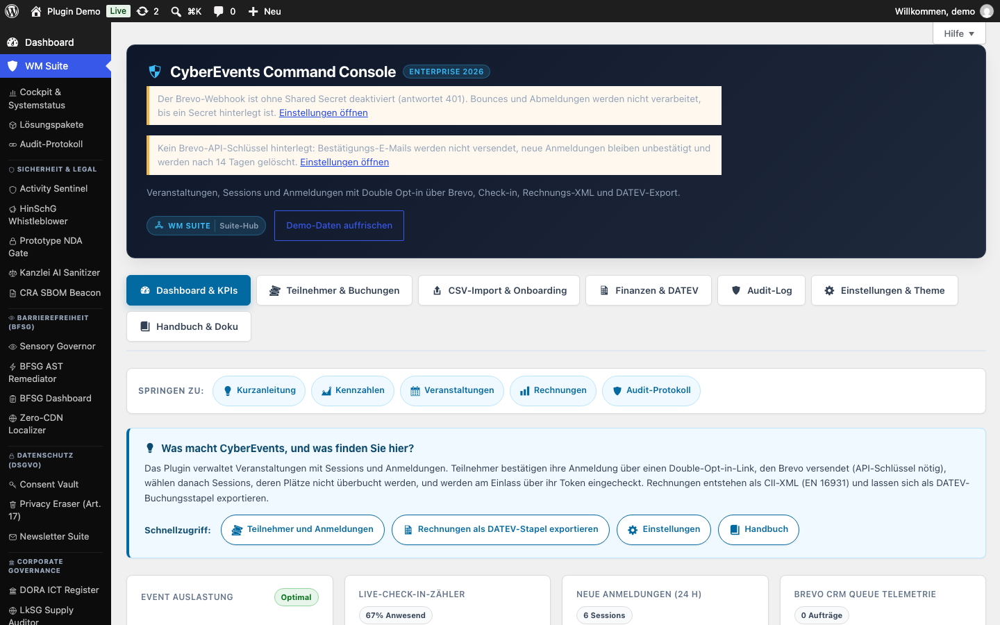
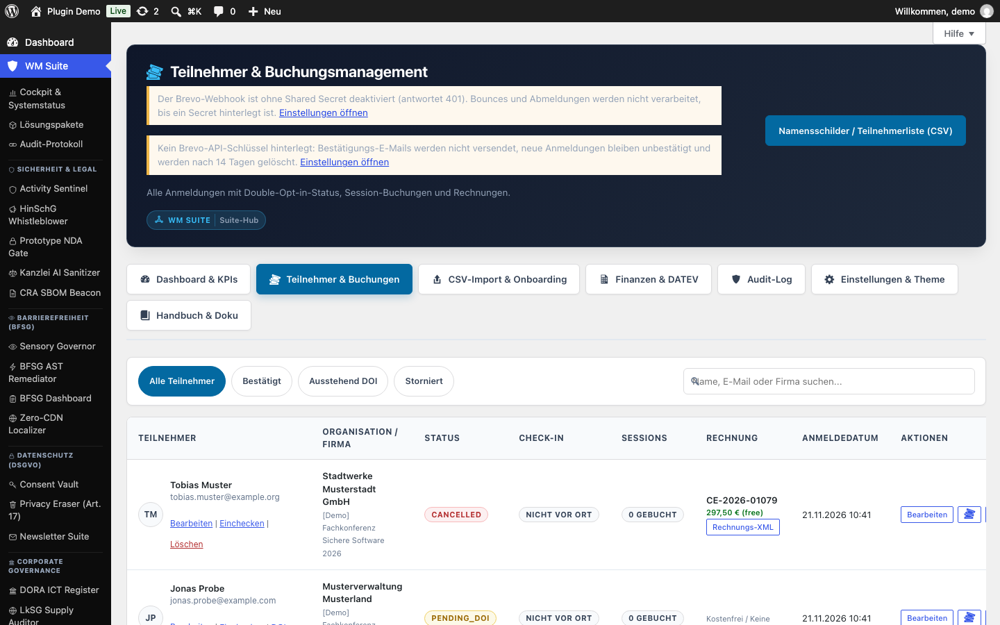
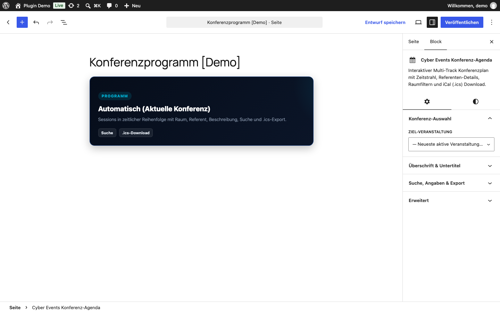
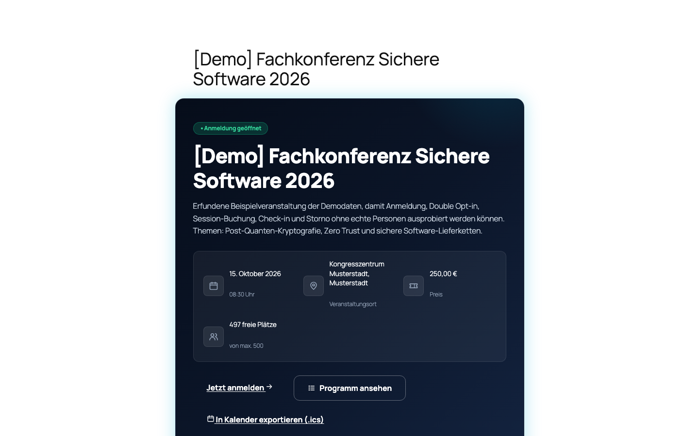

# WM Cyber Events Core

<p align="center">
  <a href="README.md"></a>
  <a href="README.de.md"></a>
  <a href="README.es.md"></a>
  <a href="#translated-documentation"></a>
</p>

<p align="center">
  <a href="https://wordpress.org"></a>
  <a href="https://php.net"></a>
  
</p>

> **Events, sessions and registrations for WordPress with double opt-in through Brevo, capacity-checked session booking, check-in, invoice XML (EN 16931) and DATEV export**  
> **Plugin page:** [https://arnoldwender.com/wordpress-plugins/wm-cyber-events-core/](https://arnoldwender.com/wordpress-plugins/wm-cyber-events-core/)  
> **Built with an agentic workflow:** developed with AI coding agents. Review and test it like any third-party code before you use it in production.  
> **Support & Liability:** Zero support — reproducible bugs on [GitHub Issues](https://github.com/arnoldwender/wm-wp-cyber-events-core/issues) only · no private support · AS IS / no liability ([SUPPORT.md](SUPPORT.md))

> This README describes what the plugin ships, measured against the code. An earlier edition described an unregistered `wm_cyber_calendar` tag (the registered shortcode is `[cybevents_calendar]`), WP-CLI commands `wp cybevents status|verify|export`, a REST namespace `wm-events/v1`, ZUGFeRD 2.3 / Factur-X hybrid PDF invoices, row-level locking "under high concurrency", GoBD and BFSG 2025 compliance and a hook `wm_cybevents_ticket_booked`; none of those exist in this repository. The code audit behind this rewrite is docs/AUDIT-2026-09-15.md.

---

## Showcase

!WM Cyber Events Core banner

Superseded promotional banners and early UI mockups were archived non-destructively in `versionen/visuals-pre-2026-11-19/`. The screenshots below come from a clean WordPress with the plugin's fictional demo data.

| Command Console | Attendee Management | Gutenberg Block Editor | Public Multi-View Portal |
|---|---|---|---|
|  |  |  |  |

---

## What the plugin does

1. **Events, sessions, venues.** Post types `cybevent` (archive at `/veranstaltungen/`) and `cybsession`, and a venue taxonomy `cybvenue` with address, capacity, a wheelchair-access flag and a map link. Saving an event or a session in the editor copies its fields into the plugin tables `wp_cybevents_events` and `wp_cybevents_sessions`, which the blocks, routes and exports read. Events can also be created and edited in a quick-edit dialog on the plugin dashboard, which additionally sets the status `archived`.
2. **Registration with double opt-in.** The registration form (block or `[cybevents_registration event_id="…"]`) posts to `POST /wp-json/cybevents/v1/register`: first name, last name, e-mail, company (optional), a profile photo (JPEG, PNG or WebP up to 5 MB, optional), privacy consent (required) and photo consent. At most 15 requests per minute per IP; a filled hidden honeypot field is refused. The registration is stored as `pending_doi` with SHA-256 hashes of a participant token and a DOI token, and a queue job asks Brevo (`POST /v3/contacts/doubleOptinConfirmation`, template and list from the settings) to send the confirmation mail. The link in that mail leads to `GET /wp-json/cybevents/v1/confirm`, which confirms the registration once and redirects to the first published page that contains the session selector. Without a Brevo API key no mail is sent and the admin screens say so.
3. **Session booking.** A confirmed participant chooses sessions on that page (block or `[cybevents_session_selector]`, participant token from the link). Each seat is taken with one conditional `UPDATE … SET belegt = belegt + 1 WHERE id = … AND belegt < kapazitaet`, so two requests for the last seat cannot both get it. Changing the selection books the new sessions first and releases the old ones only when every new seat was secured.
4. **Admission waiting room.** Off by default (`admission_per_minute`, 0). Set to a number, it counts the requests reaching `POST /register` and `POST /book-sessions` per minute, per gate and per event, and answers everything over the limit with HTTP 503 and a `Retry-After` **before any booking query runs**. Measured on a local WordPress install on 2026-09-16 with the database backend: an admitted booking costs 16 queries, a refused one 2 — the transient the counter itself is. With a persistent object cache the refused one costs none. It is a throttle, not a queue: a refused request holds no seat, and the answer says so in words. With a persistent object cache (Redis, Memcached) the counter is an atomic increment there; without one it is a transient, so the refused request still costs one read and one write of the options table. The settings screen names the backend in use and warns when it is the database; `wp cybevents admission [--event=<id>] [--reset]` reports and clears the current window, and the hub reports `admission_limit` and `admission_backend`.
5. **Seat map.** The occupancy of every session of an event as an SVG — one cell per seat, one row per session — from the block *Cyber Events Sitzplan* or `[cybevents_seat_map event_id="…"]`. It stays current over Server-Sent Events: `GET /wp-json/cybevents/v1/seat-stream?event_id=…` holds the connection open for 30 seconds, writes an event only when the occupancy digest changed, sends a keep-alive comment every 10 seconds and then asks the browser to reconnect — one connected viewer occupies one PHP process for that long, which is why the stream is bounded. The stream carries occupancy numbers only: no names, no addresses, no tokens, which is why it needs none. A session over 400 seats is drawn as a bar instead of 400 rectangles; a table beside the drawing carries the same numbers for screen readers. With `?token=` of a confirmed registration the rows that person holds are marked and clicking one books or releases a seat through `POST /book-sessions`, so the conditional `UPDATE` still decides the last seat; the token is read from the URL and never written into the markup. There is no WebSocket: WordPress has no socket server.
6. **Check-in and ticket pass.** `POST /wp-json/cybevents/v1/checkin` (an administrator, or the header `X-CyberEvents-Staff-Key` with the staff key from the settings) checks a confirmed registration in exactly once; a second scan answers 409. The ticket pass block and `GET /wp-json/cybevents/v1/ticket?token=…` show confirmed registrations only (sent `private, no-store`). The attendee list in the admin toggles check-in by hand.
7. **Frontend blocks** in the category "Cyber Events Suite": Event Hero (countdown, date, location, price, free seats, buttons), Registration Form, Agenda (sessions in time order with room, speaker, search and `.ics` export; also `[cybevents_agenda]`), Speaker Grid, Calendar Widget (`.ics` download and links to Google Calendar, Outlook Web and Microsoft 365), Session Selector, Seat Map, Ticket Pass, Trust Block (cards on double opt-in and deletion periods, labelled forms, own assets, audit log and tokens, invoice XML and DATEV), Events Grid (active, active and archived, or archived events) and Calendar Views (7 interactive views over stored active events and sessions, accepting an optional `month` attribute / `[cybevents_calendar month="YYYY-MM"]` or `?cyb_month=YYYY-MM`). Headings, buttons and badges come from the event and are translatable; the editor offers only settings the renderers read.
8. **Calendar files.** `GET /wp-json/cybevents/v1/calendar?event_id=…` returns the event as `.ics` with one reminder a day before; with `?token=…` it adds the participant's booked sessions, each with a reminder 15 minutes before. Times are converted from the site's time zone to UTC.
9. **Invoice XML.** `CyberEvents_Invoicing::create_invoice()` and `cancel_invoice()` write Cross Industry Invoice XML with the EN 16931 guideline ID: invoices (type 380) and credit notes (type 381, positive amounts, reference to the original), seller data from the settings (no invoice without them), amounts computed in cents, SEPA payment means when an IBAN is set, numbers from a counter that is never lowered. The XML is stored with the invoice and can be viewed and copied in the attendee list. The test suite validates it with Mustang-CLI. The registration flow does not call these functions (see Known issues).
10. **Exports.** Attendee list as CSV (confirmed registrations, semicolon, cells starting with `=`, `+`, `-` or `@` neutralised; requires a confirmation checkbox and writes an audit entry). DATEV EXTF 700 booking batch, category 21, version 13, for a period within one calendar year, in Windows-1252, with the receivables and revenue accounts from the settings. WordPress privacy exporter and eraser for registrations and invoices.
11. **CSV import** of participants into one event (columns `email`/`E-Mail`, `vorname`/`first_name`, `nachname`/`last_name`, `firma`/`company`; semicolon or comma), skipping addresses already registered for that event. Imported people are stored as confirmed, without privacy consent, without a DOI time and without a usable token; no mail is sent.
12. **Retention and audit log.** A daily cron deletes registrations still unconfirmed after 14 days (releasing their seats and deleting the photo) and pseudonymises audit entries older than 90 days, except invoice events. Every audit entry is chained with HMAC-SHA256 (key from `AUTH_KEY` in `wp-config.php`, otherwise a key stored in the database, which the admin flags); `wp cybevents verify-audit` and the audit screen report the first entry that does not check out. Tamper evidence, not immutability. Self-service cancellation (`POST /wp-json/cybevents/v1/cancel-registration` with the participant token) releases the seats, issues a credit note when an invoice exists and queues a Brevo contact update.
13. **Brevo webhook.** `POST /wp-json/cybevents/v1/brevo-webhook` with the header `X-Brevo-Webhook-Secret`: `hard_bounce`, `soft_bounce`, `spam` and `unsubscribed` mark every registration of that address as `bounced` and release its seats. Without a secret in the settings the route answers 401.
14. **Admin.** Menu *Cyber Events* (capability `manage_options`): dashboard with counts from the tables, event table and quick edit, invoice summary and the latest audit entries; events, venues and sessions; attendees (filter, search, edit dialog with photo, status, check-in, invoice number and consents; manual DOI confirmation; delete; CSV export; XML viewer); CSV import; DATEV export; audit log with chain verification; settings (theme, Brevo and staff key, invoice seller and DATEV accounts, captcha, demo data and factory reset); handbook. A dashboard widget with event, confirmed and pending counts; help tabs on the plugin screens.
15. **Theme.** Presets: inherit the active theme's colours and fonts (default), several colour presets, high contrast (black on white), or custom colours with an uploaded `.css` file (up to 2 MB, tags stripped) and inline CSS. The plugin loads no font files. Themes can override `cybevents/single-cybevent.php`, `cybevents/archive-cybevent.php` and `cybevents/single-cybsession.php`.
16. **WP-CLI.** `wp cybevents list` (events with their number of confirmed registrations), `wp cybevents queue-run`, `wp cybevents verify-audit` (exit code 1 on a broken chain), `wp cybevents admission [--event=<id>] [--reset]` (waiting room state and counters), `wp cybevents demodaten --import|--delete|--reset`.
17. **WM Suite Hub spoke.** `includes/class-cyber-events-spoke-adapter.php` registers through `wm_register_suite_module`: health (`ERROR` on a broken audit chain, `NEEDS_CONFIG` without Brevo key or webhook secret, `DEGRADED` without the queue event or with failed jobs), counts as telemetry, an SBOM entry with the SHA-256 of the main file, actions `self_test` and `audit_verify`.
18. **Ecosystem bridges & developer hooks.** Registers WordPress 6.5+ Block Bindings source `wm-cybevents/metrics`, GenerateBlocks 2.x Dynamic Tag `wm_cybevents_metric`, action `wm_cybevents_ready`, and filters `wm_cybevents_metric_value`, `wm_cybevents_public_rest_rate_limit`, and `wm_cybevents_ics_output`.

### Not shipped

No invoice or payment in the registration flow, no PDF or ZUGFeRD/Factur-X hybrid file, no XRechnung routing (Leitweg-ID), no QR code, no working captcha widget, no waiting list, no WebSocket (the seat map streams over Server-Sent Events), no mail sent by the plugin itself (Brevo sends the confirmation mail), no track filters on the agenda, and no statement that a site using the plugin meets GDPR, BFSG or tax requirements.

---

## Quick start

1. Install and activate the plugin (WordPress 6.9+, PHP 8.3+). Activation creates the database tables, default options and cron schedules without publishing sample content; optional fictional demo data can be imported under **Cyber Events › Einstellungen › Demodaten & Reset** or with `wp cybevents demodaten --import`.
2. Open **Cyber Events › Einstellungen**: under *Brevo CRM & Webhooks* enter the API key, the DOI template ID (a Brevo double opt-in template) and the list ID, a webhook secret, and a staff key if a scanner will call the check-in route; under *Rechnungen & DATEV* the seller data if invoices are used.
3. Create an event under **Cyber Events › Neue Veranstaltung** (date, location, capacity, price) and its sessions under **Neue Session**, selecting the event.
4. Put the registration form block (or `[cybevents_registration event_id="…"]`) on a page, and the session selector block (or `[cybevents_session_selector]`) on a published page: the confirmation link leads to the first such page.
5. Make sure WP-Cron runs every minute (a real cron job on sites with little traffic) or run `wp cybevents queue-run`, otherwise no confirmation mail leaves the queue.

### Options

| Option | Content |
| --- | --- |
| `cybevents_settings` | Array: Brevo API key, webhook secret, DOI template ID (default 1), list ID (default 2), staff scanner key, admissions per minute (`admission_per_minute`, default 0 = waiting room off), invoice prefix (default `CE-2026-`), invoice counter (1000), seller name, street, postcode, city, country (`DE`), VAT ID, tax number, e-mail, IBAN, DATEV adviser and client numbers (`1001`, `10001`), account length (`4`), revenue and receivables accounts (`8400`, `1400`), captcha flag and keys, theme preset, custom colours, radius and CSS |
| `cybevents_invoice_sequence` | Last invoice or credit note number handed out |
| `cybevents_audit_chain_tip` | Hash of the last audit entry |
| `cybevents_db_version` | Schema version (3) |
| `wm_cybevents_delete_data_on_uninstall` | Opt-in flag (`0` default): when `0`, uninstall preserves all tables and options; when `1`, uninstall drops the 7 custom tables and deletes plugin options |

Custom tables: `wp_cybevents_events`, `wp_cybevents_sessions`, `wp_cybevents_registrations`, `wp_cybevents_registration_sessions`, `wp_cybevents_invoices`, `wp_cybevents_queue`, `wp_cybevents_audit_log`. By default (`D-UNINSTALL`), uninstall preserves all tables and options; when `wm_cybevents_delete_data_on_uninstall` is enabled in the settings, uninstall drops the 7 custom tables and deletes the plugin options (posts, venues, uploaded photos and the uploaded theme file stay).

---

## Developers

Routes, blocks, classes, cron events, the hub adapter and the tests: **[DEVELOPERS.md](DEVELOPERS.md)**. Architecture and flows: [docs/ARCHITECTURE.md](docs/ARCHITECTURE.md). Blocks: [docs/GUTENBERG-BLOCKS.md](docs/GUTENBERG-BLOCKS.md).

```bash
php tests/test-suite.php          # 154 standalone assertions, no WordPress needed
bash tests/run-mutations.sh       # 215 mutations, each must turn the suite red
bash tests/validate-invoice-xml.sh   # invoice and credit note XML through Mustang-CLI (Java 11+)
php tests/test-pot-freshness.php  # every string the code translates has an entry in the .pot (needs wp-cli)
```

### Known issues

- **Optional demo content (`Demodaten`).** Clicking *Demo-Daten auffrischen* (Dashboard) or *Demodaten importieren* (*Einstellungen › Demodaten & Reset*), or running `wp cybevents demodaten --import`, creates a published demo event and page "[Demo] Fachkonferenz Sichere Software 2026" with a 250 € registration form, a published session-selection page, four venues, six sessions (one fully booked, one overlapping another) and five registrations (two checked in, one waiting for the double opt-in, one cancelled). Every name, address and company is invented; e-mail addresses and websites use the reserved `example.com`, `example.org` and `example.net` domains, and a test fails if the demo data names another domain. *Einstellungen › Demodaten & Reset › Demodaten bereinigen* removes `[Demo]` events, their sessions, registrations and invoices, the four demo venues, and the two recorded demo pages.
- **Calendar Views** (`[cybevents_calendar]`, `[cybevents_calendar_views]`, `[wm_events_views]` and its block) reads stored active events and sessions and shows a clean empty state when no records exist. View switching and filter controls are rendered server-side and updated client-side via `onclick`/`onchange` handlers.
- **Paid events** show their price; the registration flow creates no invoice and takes no payment. Invoices come only from the demo seeder, and credit notes from self-service cancellation of an invoiced registration.
- **Capabilities.** Events and sessions use the capability type `post`, so authors can create them; a draft session of an active event is bookable; saving an event in the block editor turns an `archived` status back into `active` or `draft`.
- **Deleting an event** on the dashboard removes its row and trashes its post; its sessions, registrations and invoices stay.
- **Imported participants** have no token, so they cannot open the session selector, the ticket pass or a cancellation link.
- **Routes without a shipped client.** Check-in, ticket, cancellation, avatar upload and venues are REST routes; no page or script in the plugin calls them, and the plugin sends no cancellation link.
- **Friendly Captcha** settings have no effect: the bundled script renders no widget, so the check is skipped.
- **Ability** `cybevents/manage-registrations` (Abilities API) returns `success` without data.
- **DATEV.** Every row carries tax key 3; accounts and keys have to be checked with a tax adviser.
- **Events Grid** buttons link to `#cybevents-registration-form` on the same page, whichever event the card shows.

---

## Translated documentation

`languages/` carries precompiled `.po`, `.mo` and JED `.json` catalogs for the 24 official EU languages plus Arabic, Turkish and US English (28 catalogs in total), regenerated from the current source template `languages/wm-cyber-events-core.pot` and guarded by `tests/test-pot-freshness.php`.

Translated READMEs live in `docs/translations/README.<lang>.md`: **their headings are translated and their bodies carry the English text of this file**, which is the reference — a translated table of contents over an English document. Full German and Spanish documentation lives in [README.de.md](README.de.md) and [README.es.md](README.es.md).

| Language (Native) | Locale Code | Language (Native) | Locale Code |
|---|---|---|---|
| [Български](docs/translations/README.bg.md) | `bg_BG` | [Magyar](docs/translations/README.hu.md) | `hu_HU` |
| [Čeština](docs/translations/README.cs.md) | `cs_CZ` | [Italiano](docs/translations/README.it.md) | `it_IT` |
| [Dansk](docs/translations/README.da.md) | `da_DK` | [Lietuvių](docs/translations/README.lt.md) | `lt_LT` |
| [Deutsch](README.de.md) | `de_DE` | [Latviešu](docs/translations/README.lv.md) | `lv_LV` |
| [Ελληνικά](docs/translations/README.el.md) | `el_GR` | [Malti](docs/translations/README.mt.md) | `mt_MT` |
| [English](README.md) | `en_GB` | [Nederlands](docs/translations/README.nl.md) | `nl_NL` |
| [Español](README.es.md) | `es_ES` | [Polski](docs/translations/README.pl.md) | `pl_PL` |
| [Eesti](docs/translations/README.et.md) | `et_EE` | [Português](docs/translations/README.pt.md) | `pt_PT` |
| [Suomi](docs/translations/README.fi.md) | `fi_FI` | [Română](docs/translations/README.ro.md) | `ro_RO` |
| [Français](docs/translations/README.fr.md) | `fr_FR` | [Slovenčina](docs/translations/README.sk.md) | `sk_SK` |
| [Gaeilge](docs/translations/README.ga.md) | `ga_IE` | [Slovenščina](docs/translations/README.sl.md) | `sl_SI` |
| [Hrvatski](docs/translations/README.hr.md) | `hr_HR` | [Svenska](docs/translations/README.sv.md) | `sv_SE` |

---

## Compliance

- **No external assets:** scripts, styles and icons are served from the plugin; no fonts, no CDN, no tracking. The server talks to Brevo only when an API key is set; the calendar links open Google or Microsoft in the visitor's browser when clicked.
- **Personal data:** name, e-mail, company, optional photo, consents, DOI and check-in times and session bookings are stored in the plugin's tables; name, e-mail, company and event title go to Brevo for the confirmation mail, with the list ID from the settings. Unconfirmed registrations are deleted after 14 days; confirmed registrations and invoices are not deleted automatically. The WordPress privacy exporter and eraser cover registrations, invoices, audit entries and queued mails.
- **Accessibility:** form fields with visible labels, required fields marked, feedback in a live region, a high-contrast preset, visible focus rings. No conformity statement is made.
- **Invoices:** the XML is checked against EN 16931 with Mustang-CLI in the tests; whether invoices meet legal requirements in a given case is for a tax adviser to decide.

---

## Contribution & Security

- [CONTRIBUTING.md](CONTRIBUTING.md) · [SECURITY.md](SECURITY.md) · [CHANGELOG.md](CHANGELOG.md)

---

## License

Distributed under the **GNU General Public License v2 or later** (`LICENSE`); the plugin header, `readme.txt` and the SBOM the plugin reports to the hub (`GPL-2.0-or-later`) say the same.  
Copyright (C) 2026 Arnold Wender.  
