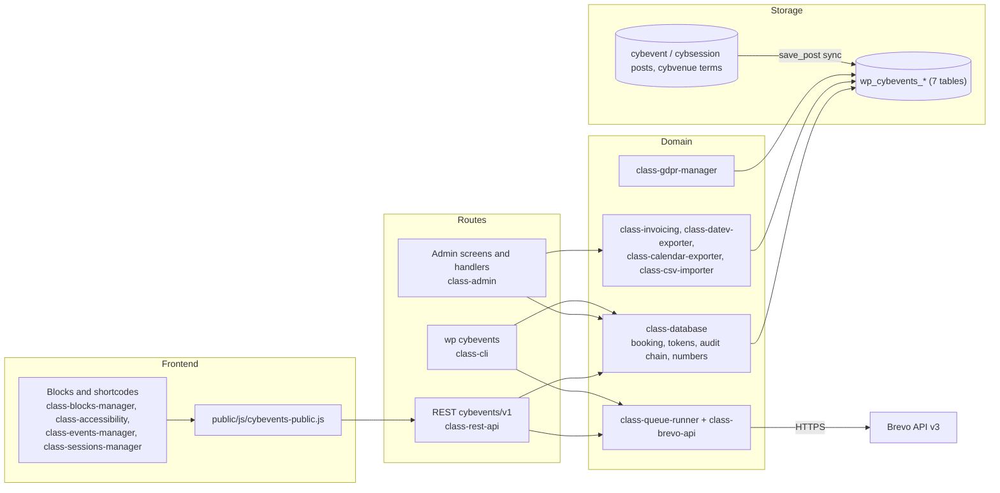
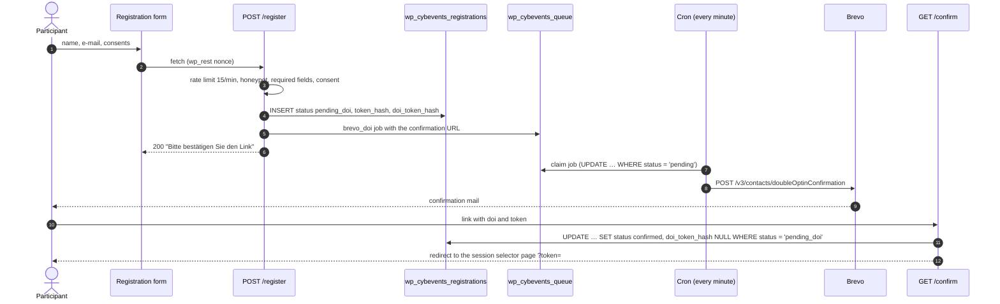
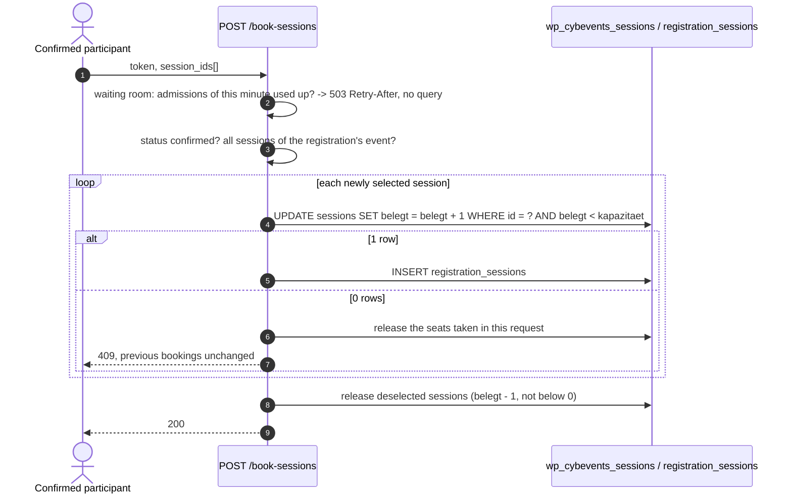

# Architecture — WM Cyber Events Core

> Measured against the code on 2026-09-15. The previous edition was written for a client and described classes and routes that do not exist (`class-invoice-manager.php`, `class-events-cli.php`, `/select-sessions`, `/verify-doi`), transactions with `START TRANSACTION`/`ROLLBACK`, PDF/A-3 invoices, a `-STORNO` credit note number, SVG QR codes, salted SHA-256 pseudonymisation, a 30 requests per minute limit on every endpoint and BFSG/BITV conformity. Classes, routes and data are listed in [DEVELOPERS.md](../DEVELOPERS.md); this file describes how the parts work together.

---

## 1. Layers



The post types are the editing surface; the tables are what blocks, routes, exports and the queue read. `save_post` copies an event or session post into its table row; the dashboard quick edit writes the row and updates the post.

---

## 2. Registration and confirmation



Without a Brevo API key the job fails and is retried with backoff up to five times; the admin screens show a notice. Registrations still `pending_doi` after 14 days are deleted by the daily retention job.

---

## 3. Booking a session



The capacity check happens in the `WHERE` of the `UPDATE`, which the database evaluates on the locked row: of two requests for the last seat exactly one changes the row. `book_session_atomic()` returns `true` or a `WP_Error` and never `false`; a database error (`false` from `$wpdb->query()`) is reported as such and not as "full".

### The waiting room in front of it

The row lock settles who gets the seat; it does nothing about what the losers cost. Ten thousand requests for the last fifty seats each walk the session table, take a lock and write a row, and the ones that arrive too late cost exactly as much as the ones that arrive in time. `CyberEvents_Waiting_Room::admit()` runs before all of that — before the token lookup, the scope check and the locks — and answers everything over `admission_per_minute` with HTTP 503 and a `Retry-After`. Measured on a local WordPress install on 2026-09-16, with the database backend and a real token: an admitted booking costs 16 queries, a refused one 2 — the transient the counter itself is. With a persistent object cache the refused one costs none, which is the whole reason `backend()` is reported.

It counts per gate (`register`, `book`) and per event, so a burst on one event cannot close another, and registration cannot close booking. It is off by default, because switching it on changes how public routes answer.

**It is a throttle, not a queue.** A refused request holds no place in line, and the message says so: the `Retry-After` is when the next window opens, not when a seat is reserved. Calling it a queue would promise something the counter cannot keep.

Where the counter lives decides what a refusal actually saves. With a persistent object cache (`wp_using_ext_object_cache()`) it is `wp_cache_add()` plus an atomic `wp_cache_incr()`, and the refused request touches no database at all. Without one it is a transient — a row in the options table — so the heavy work is still skipped but the counter itself costs a read and a write. `backend()` reports which, the settings screen shows it and warns about the second, and the hub carries it as `admission_backend`. A counter key the cache evicted between `add()` and `incr()` counts this request as the first of a window, never as none: the default value may not be the one that means "nobody is here".

---

## 3b. The seat map and its stream

`CyberEvents_Seat_Map::snapshot()` reads capacity and occupancy of every session of an event and hashes
the numbers — the id, the capacity and the taken count, nothing else — into a digest. `render_svg()`
draws one cell per seat and one row per session; above 400 seats a row becomes a bar, because four
hundred rectangles are a drawing nobody reads. Beside the drawing stands a table with the same numbers,
because a screen reader gets nothing from a rectangle.

`GET /seat-stream?event_id=…` writes `text/event-stream` directly and exits: a `WP_REST_Response` cannot
hold a connection open. It reads the occupancy every two seconds, writes an event **only when the digest
changed**, sends a comment line every ten seconds so a proxy does not close an idle connection, and stops
after thirty seconds with a `retry` the browser obeys. That bound is the point: one connected viewer
occupies one PHP process for as long as the stream lives, so the stream lives briefly and the browser
comes back. `X-Accel-Buffering: no` keeps nginx from holding the bytes.

The stream is public because it carries nothing private: occupancy numbers per session, no names, no
addresses, no tokens. The participant token is **not** written into the markup either — it already
travels in the URL, and a copy in an attribute would sit in whatever cache holds the page, which is the
defect this plugin already had to fix on the ticket route. The script reads it from the query string.

Clicking a row books or releases a seat through `POST /book-sessions`, so the conditional UPDATE above
still decides who gets the last seat, and the waiting room in front of that route still applies.

The specification asks for "WebSocket / Server-Sent Events". WordPress has no socket server; this is
SSE, and the README says so.

---

## 4. Check-in

`POST /checkin` with a participant token or registration id. Only `confirmed` registrations are admitted (403 otherwise). The check-in is one `UPDATE … SET checked_in = 1 WHERE id = ? AND checked_in = 0`: one affected row is a successful check-in, zero rows answer 409 "Bereits eingecheckt". Permission: `manage_options` or the header `X-CyberEvents-Staff-Key` matching the stored staff key.

---

## 5. Cancellation, bounces, deletion

| Trigger | Path | Seats | Photo | Invoice | Audit |
| --- | --- | --- | --- | --- | --- |
| `POST /cancel-registration` | `cancel_registration_self_service()` | released | kept | credit note when an invoice number is set | `self_service_cancelled` with the reason |
| Brevo webhook (bounce, spam, unsubscribe) | `handle_brevo_webhook()` | released | kept | unchanged | count of affected registrations |
| Retention job (pending after 14 days) | `delete_registration()` | released | deleted | — | `gdpr_retention_purge` with the count |
| Admin delete | `delete_registration()` | released | deleted | unchanged | `registration_deleted` |
| WordPress eraser | `erase_personal_data()` | released | deleted | row anonymised when invoiced, invoice unchanged; otherwise row deleted | older entries naming the address pseudonymised |

---

## 6. Invoices and exports

- `create_invoice()` needs complete seller settings and a tax rate above 0; it computes amounts in cents, draws a number from `cybevents_invoice_sequence` under a database lock and stores the CII XML with the row.
- `cancel_invoice()` writes a credit note (type 381, own number, reference to the original) and marks the original `cancelled`.
- Callers: the demo seeder and self-service cancellation. The registration flow creates no invoice.
- DATEV: `generate_export()` reads invoices and credit notes of a period within one year and writes EXTF 700 category 21; the admin handler converts it to Windows-1252.
- iCalendar: `generate_ics()` converts stored site times with the site's time zone to UTC.

---

## 7. Audit chain

Each `log_audit()` call stores a SHA-256 content digest over event type, object id, user id, IP, details and time, and an entry hash `HMAC-SHA256(prev_hash | content_digest)` under a database lock; the option `cybevents_audit_chain_tip` mirrors the last hash, so removing the newest entries is detected too. The key is `AUTH_KEY` from `wp-config.php`; without it the auth salt WordPress keeps in the database is used, which the admin flags. Pseudonymisation after 90 days blanks user, IP and details, keeps digest and links, and stores a keyed residual MAC over the remaining fields and the pseudonymisation time, so a row marked pseudonymised cannot be edited unnoticed. Verification: `wp cybevents verify-audit`, the audit screen, the hub health and the hub action `audit_verify`. The chain proves tampering after the fact; anyone with the key can rewrite it.

---

## 8. Boundaries

1. Seats change only through `book_session_atomic()` and `cancel_session_atomic()`; never read `belegt`, compute in PHP and write it back.
2. Token values are never stored, only their SHA-256 hashes; the queue payload is reduced to the registration id when a job ends.
3. Audit details carry no e-mail address or request payload.
4. Frontend assets are served from the plugin; no CDN, no remote fonts.
5. A value the code does not recognise keeps what is stored or produces an error; it never becomes the value that means "confirmed", "free" or "healthy".

---

## 9. Open decisions

Invoices in the registration flow, the DATEV tax key, capabilities of the post types and the version number: see AUDIT-2026-09-15.md §8–9 and the Known issues in the [README](../README.md#known-issues). (Fictional demo data import became strictly opt-in and Calendar Views became database-driven on 2026-11-25.)

---

<!-- wm-measured-inventory -->

## Measured inventory

Regenerated from the code, never hand-edited. Everything above this line is written by hand and stays.

```bash
python3 the fleet's architecture inventory tool wm-cyber-events-core --append-to docs/ARCHITECTURE.md
```

## Inventory by layer

**27 PHP files, 14251 lines** (excluding `tests/`, `vendor/`, `node_modules/`, `languages/`).

| Layer | Files | Lines |
|---|---:|---:|
| `(raíz)` | 2 | 727 |
| `includes` | 25 | 13524 |

---

## Classes

| Class | File |
|---|---|
| `CyberEvents_Accessibility` | [`includes/class-accessibility.php`](../includes/class-accessibility.php) |
| `CyberEvents_Activator` | [`includes/class-activator.php`](../includes/class-activator.php) |
| `CyberEvents_Admin` | [`includes/class-admin.php`](../includes/class-admin.php) |
| `CyberEvents_Blocks_Manager` | [`includes/class-blocks-manager.php`](../includes/class-blocks-manager.php) |
| `CyberEvents_Brevo_API` | [`includes/class-brevo-api.php`](../includes/class-brevo-api.php) |
| `CyberEvents_CLI_Command` | [`includes/class-cli.php`](../includes/class-cli.php) |
| `CyberEvents_CSV_Importer` | [`includes/class-csv-importer.php`](../includes/class-csv-importer.php) |
| `CyberEvents_Calendar_Exporter` | [`includes/class-calendar-exporter.php`](../includes/class-calendar-exporter.php) |
| `CyberEvents_Calendar_Views` | [`includes/class-calendar-views.php`](../includes/class-calendar-views.php) |
| `CyberEvents_DATEV_Exporter` | [`includes/class-datev-exporter.php`](../includes/class-datev-exporter.php) |
| `CyberEvents_Database` | [`includes/class-database.php`](../includes/class-database.php) |
| `CyberEvents_Deactivator` | [`includes/class-deactivator.php`](../includes/class-deactivator.php) |
| `CyberEvents_Events_Manager` | [`includes/class-events-manager.php`](../includes/class-events-manager.php) |
| `CyberEvents_GDPR_Manager` | [`includes/class-gdpr-manager.php`](../includes/class-gdpr-manager.php) |
| `CyberEvents_Icons` | [`includes/class-icons.php`](../includes/class-icons.php) |
| `CyberEvents_Invoicing` | [`includes/class-invoicing.php`](../includes/class-invoicing.php) |
| `CyberEvents_Queue_Runner` | [`includes/class-queue-runner.php`](../includes/class-queue-runner.php) |
| `CyberEvents_REST_API` | [`includes/class-rest-api.php`](../includes/class-rest-api.php) |
| `CyberEvents_Seat_Map` | [`includes/class-seat-map.php`](../includes/class-seat-map.php) |
| `CyberEvents_Seeder` | [`includes/class-seeder.php`](../includes/class-seeder.php) |
| `CyberEvents_Sessions_Manager` | [`includes/class-sessions-manager.php`](../includes/class-sessions-manager.php) |
| `CyberEvents_Spoke_Adapter` | [`includes/class-cyber-events-spoke-adapter.php`](../includes/class-cyber-events-spoke-adapter.php) |
| `CyberEvents_Theme_Manager` | [`includes/class-theme-manager.php`](../includes/class-theme-manager.php) |
| `CyberEvents_Venues_Manager` | [`includes/class-venues-manager.php`](../includes/class-venues-manager.php) |
| `CyberEvents_Waiting_Room` | [`includes/class-waiting-room.php`](../includes/class-waiting-room.php) |

---

## Entry points

**REST routes:** `/book-sessions`, `/brevo-webhook`, `/calendar`, `/cancel-registration`, `/checkin`, `/confirm`, `/register`, `/seat-snapshot`, `/seat-stream`, `/session-selection`, `/ticket`, `/upload-avatar`, `/venues`

**WP-CLI:** `cybevents`

**Shortcodes:** `cybevents_agenda`, `cybevents_calendar`, `cybevents_calendar_views`, `cybevents_registration`, `cybevents_seat_map`, `cybevents_session_selector`, `wm_events_views`

**Gutenberg blocks:** `wm-cyber-events/agenda-matrix`, `wm-cyber-events/calendar-views`, `wm-cyber-events/calendar-widget`, `wm-cyber-events/event-hero`, `wm-cyber-events/events-grid`, `wm-cyber-events/registration-form`, `wm-cyber-events/seat-map`, `wm-cyber-events/security-trust-badge`, `wm-cyber-events/session-selector`, `wm-cyber-events/speaker-grid`, `wm-cyber-events/ticket-pass-verifier`

**Cron events:** `cybevents_gdpr_retention_cron`, `cybevents_process_queue_cron`

---

## Persistence — who writes each key and who reads it

| Key | Written by | Read by |
|---|---|---|
| `wm_cybevents_delete_data_on_uninstall` | `includes/class-admin.php` | `includes/class-admin.php`, `uninstall.php` |

Every key has exactly one writing layer and at least one reader.


**Tables** (prefixed with `$wpdb->prefix`): `cybevents_audit`, `cybevents_audit_log`, `cybevents_events`, `cybevents_invoice_number`, `cybevents_invoices`, `cybevents_queue`, `cybevents_registration_sessions`, `cybevents_registrations`, `cybevents_sessions`

---

## Gates

- `tests/bootstrap-harness.php`
- `tests/generate-invoice-samples.php`
- `tests/mutations.php`
- `tests/run-mutations.sh`
- `tests/test-audit-chain.php`
- `tests/test-concurrency.php`
- `tests/test-csv-dedup.php`
- `tests/test-deep-features.php`
- `tests/test-i18n.php`
- `tests/test-invoicing-flow.php`
- `tests/test-pot-freshness.php`
- `tests/test-registration-flow.php`
- `tests/test-rest-booking.php`
- `tests/test-security.php`
- `tests/test-suite.php`
- `tests/test-theme-manager.php`
- `tests/test-ui-family.php`
- `tests/test-zugferd.php`
- `tests/validate-invoice-xml.sh`
- `.github/workflows/ci.yml`

What CI actually runs is in the workflow files above — a test file that no workflow invokes is not a gate.

---

## Drift detected against the documentation

Nothing measurable: versions agree and every class named in the documents exists.

